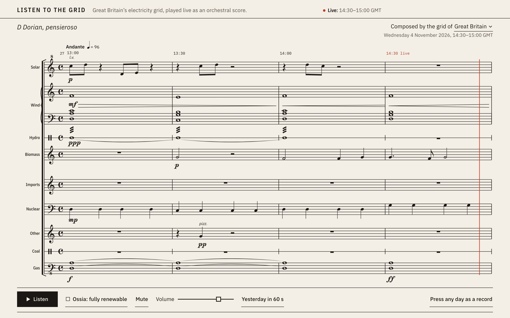

# Listen to the Grid

[](https://harryfreeman.dev)

Great Britain's electricity grid, played live as an orchestral score from the National Energy System Operator's
half-hourly figures. Each source of power has its own staff and its own voice (wind a string pad, solar bells, gas
a low drone, nuclear a steady pulse) and plays louder the bigger its share; carbon intensity chooses the key, so a
clean grid sounds bright and a dirty one turns minor. The score is engraved as you listen, any day since May 2018
can be pressed as a one-minute record with its score as the sleeve, and an *ossia* re-scores the moment for a fully
renewable grid, loudness-matched so the comparison is fair. It is a way to hear what the grid is doing, and how
much of it is gas right now, without reading a chart.

**Live:** [listen.harryfreeman.dev](https://listen.harryfreeman.dev)



## Try it

Needs Node 22.12 or later.

```sh
npm ci
npm run dev
```

Open the address Vite prints (`http://localhost:5173` unless that port is busy) and press **Listen**. The page
reads NESO's public [Carbon Intensity API](https://carbonintensity.org.uk/) straight from your browser: no key, no
account, no server of its own. If the API can't be reached, the page says it is offline and plays a bundled
recording of a real day, labelled with that day's date. No model or other download is involved.

```sh
npm run build     # the static site, in dist/: about 71 kB of gzipped JavaScript, with its _headers
npm run preview   # served with the hosted headers, the Content-Security-Policy among them
```

Link to a region with `?region=north-scotland`, `?region=london` and so on (the slugs are in `src/data/regions.ts`).
`npm run build:radio` builds the piece without its score as a module another page can embed; see
[radio/README.md](radio/README.md).

**Checks.** `npm run check` runs the typecheck, lint, formatting, unit tests and dependency licences; CI runs the
same and both builds. The browser suites drive real Chromium, WebKit and Firefox against NESO's live figures, so
they run locally, one browser at a time, and not in CI:

```sh
npx playwright install chromium webkit firefox   # once
npm run shots         # every state at 1440×900 and 390×844, with behaviour checks, into shots/
npm run radio:check   # the radio embedded behind a strict Content-Security-Policy
npm run measure       # offline renders: levels, clipping, clicks, phrasing, brightness
node scripts/measure-audio.mjs --loudness   # how fair the ossia's loudness match is
npm run perf          # first engraved paint and frame cost during a replay
npm run silence       # macOS only: proves no browser the scripts drive opens an audio device
npm run check:hosted  # the build as Cloudflare Pages serves it, its policy enforced (see Hosting)
```

Every browser these scripts launch is silent (`scripts/silent.mjs`): the page gets an AudioContext with no output,
Chromium runs with `--mute-audio` and Firefox at zero volume.

## How it works

```
NESO Carbon Intensity API ──> zod schemas ──> half-hour series ──> arrange() ──> Conductor, a bar at a time
     (or the bundled day)       src/data         src/data           src/music       src/music
                                                                                       ├──> AudioEngine: live, or offline for records
                                                                                       └──> engraver ──> live score, sleeve
```

- **Data** (`src/data`, `src/feed.ts`). The latest half-hour from `/generation` and `/intensity` (or
  `/regional/regionid/{id}`), and the last week from their range endpoints. Every response is validated with zod,
  cached copies included. The page asks a few minutes after each half-hour is due, keeps the week for 25 minutes,
  and a Content-Security-Policy lets it talk to nothing but its own files and NESO.
- **Composition** (`src/music`). Pure, seeded functions. A fuel's amplitude is the square root of its share. Carbon
  intensity picks one of six modes on D, from Lydian below 60 g CO₂/kWh to Phrygian from 240 g, with 5 g of
  hysteresis so a value on a boundary doesn't flicker. The conductor writes a bar at a time in eight-bar phrases:
  one chord a bar, a half cadence at bar four and home to D at bar eight, a sung motif that repeats and answers
  itself, and a swell across each phrase that the engine plays and the score marks as hairpins. Every note is in
  the bar's key, so the score never needs an accidental.
- **Engraving** (`src/notation`). Rhythm spelt to show the beat and the middle of the bar, ties, rests, beams,
  ledger lines, octave clefs, modal key signatures (D Lydian is three sharps, D Phrygian two flats) with cancelling
  naturals at a change, dynamics where they change, entry words (*l.v.*, *pizz.*, *lontano*) lifted clear of the
  notes, tempo and bar numbers. Clefs, rests, accidentals and dynamics are glyphs from Noto Music. The live page is
  one system through the last two hours: the half-hours already past engraved whole from their own figures, then
  the live half-hour inked note by note as it sounds, with a red cursor following. A replayed day turns pages.
- **Sound** (`src/audio`). A hand-written Web Audio graph, no samples: a detuned-saw drone, a four-voice pad, FM
  bells, a felt pulse, a formant singer, filtered-noise water, plucks and grit; per-voice buses, a generated
  convolution reverb, then a glue compressor, a limiter and a soft clip. Every change of data is a ramp.
- **Records** (`src/record.ts`). A day is fetched (two requests), composed an hour a bar, engraved as a 2400 px
  sleeve and rendered offline by the same engine, faster than real time: a 16-bit, 44.1 kHz WAV with RIFF INFO and
  ID3 tags and the sleeve as cover art. The same date and place always press the same record.
- **The ossia** (`src/music/ossia.ts`). Gas, coal, nuclear, biomass, imports and other are set to zero and their
  share handed to wind, solar and hydro in proportion to each one's real share (all wind if none generated). NESO
  counts all three at 0 g, so the ossia plays at 0 g, in D Lydian. Both versions are always composed, by two
  conductors in step, so switching is instant and mid-bar. The ossia is printed in small staves over the live bar,
  labelled hypothetical, and never appears in the live label.
- **Loudness** (`src/audio/loudness.ts`, `src/audio/match.ts`). Louder sounds better to most ears, so before you
  compare them the ossia is trimmed to the real grid's integrated loudness, measured as
  [ITU-R BS.1770-4](https://www.itu.int/rec/R-REC-BS.1770) specifies: K-weighting (a high shelf and a 38 Hz high
  pass), mean square over 400 ms blocks overlapping by 75%, an absolute gate at −70 LUFS and a relative gate 10 LU
  below, then the gated mean. The page renders sixteen bars of the moment both ways offline at 48 kHz, in a
  worker, and applies the trim; until a moment is measured it uses the last trim, or a typical −2.2 dB labelled
  provisional. Records, real or ossia, are pressed to −16 LUFS, or as near as keeps their sample peak
  under −1 dBFS.
- **Honesty** (`src/ui/readout.ts`). The page says whether a figure is measured or forecast, which half-hour it is,
  when it was checked, and that regional figures are modelled. Only the newest half-hour is called live; a late
  one is "latest"; past bars are only ever half-hours NESO published, never filled in across a gap.
- **Type.** IBM Plex (Sans to read, Mono for data, Sans Condensed for signs) and Noto Music for notation, served
  from the page itself. The three faces of the first screen are preloaded so nothing moves when they arrive. The
  design (medium, type, palette, what moves and what it refuses) is written down in [IDENTITY.md](IDENTITY.md).

## What it measures / proves

- **The sound, by numbers** (`npm run measure`, offline renders at 48 kHz). The bundled day played in 60 seconds:
  RMS −16.5 dBFS, sample peak −2.9 dBFS, no clipped samples. Two eight-bar phrases over a steady mix: the loudness
  of each bar follows the intended swell (correlation 0.78) across 3.7 dB.
- **The loudness meter is the standard's.** Unit tests reproduce BS.1770's 48 kHz K-weighting coefficients and pass
  [EBU Tech 3341](https://tech.ebu.ch/publications/tech3341) cases 1 to 4, which test both gates.
- **The A/B is fair.** Unmatched, the ossia measures 1.8 to 2.7 LU louder than the real grid across the sample day
  (median 2.2). At every other half-hour the page's own measurement set the trim, and an independent render of
  the same moment, with other notes, checked it: the trimmed ossia and the real grid differ by 0.06 LU at the
  median and 0.25 LU at most (`node scripts/measure-audio.mjs --loudness`).
- **Records are at the level they claim.** The browser suite downloads each pressed WAV and re-measures it in Node
  with the same meter: −16.0 LUFS, within ±0.15 LU, as the liner notes say.
- **Nothing moves on load.** Cumulative layout shift is 0.00000 at 1440×900 and 390×844, from first paint through
  the data and the type arriving (Chromium's layout-shift API, in `npm run shots`).
- **The automation is silent.** `npm run silence` samples macOS's power assertions throughout a full run; no
  browser process the scripts start ever holds an audio assertion.
- **The behaviour holds in three engines.** `npm run shots`: 77 checks in Chromium (both sizes), 39 in WebKit and 39
  in Firefox, with zero console errors. `npm run radio:check`: 7 of 7 in each, including that `play()` is the only
  path to sound and that, when NESO can't be reached, the radio fails with a reason and makes no sound.
- **The policy is measured, then enforced.** In three browsers, every request the piece makes is a script, worker,
  stylesheet, font or image from its own origin (and one inline SVG image), or a fetch from NESO; enforced, the
  policy refuses nothing the piece needs (see Hosting).
- **Unit tests:** 218, asserting concrete values for the tricky core: schemas against real responses, UK days
  across clock changes, the conductor (in key, spellable rhythms, phrases that come home), rhythm spelling, key
  signatures, hairpins and ties across bar lines, the half-hours before now, the ossia's mix, the loudness meter
  and trim, the WAV writer, and every rule of the hosting gate and the deploy's login check.

## Limits

- It is half-hourly and behind real time: it plays the newest half-hour NESO has published. NESO marks the
  generation mix as beta, intensity is NESO's forecast where no measured figure is out yet, and regional figures are
  modelled estimates. The page labels all three.
- The music is a mapping, not a measurement. Square-root loudness, the six modes and their thresholds are design
  choices; they make changes audible, they don't make them precise.
- The ossia is a deliberately simple hypothetical. Scaling renewables up in proportion ignores storage,
  curtailment, interconnectors and when demand happens, and 0 g counts only operational emissions, as NESO does.
- Loudness matching equalises integrated loudness, not timbre: the ossia still sounds brighter, by design. The
  first switch can use the provisional trim for a few seconds while a moment is measured (1.5 to 7 s, depending on
  the machine and browser).
- A record takes a few seconds to press on a recent laptop: 6.2 s in Chromium, 5.9 s in WebKit and 5.1 s in
  Firefox in the browser suite on 11 November 2026, and longer on a slower machine.
- Sound needs a click or key press first, as every browser requires, and the page needs JavaScript.
- The browser suites need the network and run locally only; the silence check needs macOS. Served by Vite's
  preview server, WebKit warns that the three preloaded fonts were fetched twice; on a plain static server it
  doesn't, and the suite allows that one message for those three files only. It also allows WebKit's message
  refusing its own `<select>` style, which the hosted check pins down from the policy's reports (see Hosting).

## Hosting

The piece is the static build of this repository on Cloudflare Pages, project `listen-to-the-grid`, on Harry's
personal Cloudflare account, served at https://listen.harryfreeman.dev (and `listen-to-the-grid.pages.dev`).
[hosting.config.json](hosting.config.json) says where, which Cloudflare login may deploy, and holds the one indexing
switch. Everything public is `dist/` after `npm run build`: the page, its script, stylesheet and loudness worker,
the fonts and their licences, the icons, `_headers`, `robots.txt` and a 404 page. No source maps, no source, nothing
from Harry's machine. All sound is made in the browser, so there are no media files, and Pages ignoring byte ranges
does not matter here: a pressed record plays from memory, and its WAV is a `blob:` download.

**Headers** ([public/_headers](public/_headers), the only copy of the policy; `vite preview` serves it too). The
Content-Security-Policy allows exactly what was measured on 11 November 2026 (`npm run check:hosted -- measure`):
wrangler's own Pages emulation served `dist/` with every request reported under a report-only `default-src 'none'`,
while Chromium, WebKit and Firefox played the score, switched the ossia on and off with its loudness matched in the
worker, replayed a day, changed region, pressed a record, played it, downloaded both files and opened a missing page.

| Directive | Allows | Measured |
|---|---|---|
| `script-src` | `'self'` | the page's script |
| `worker-src` | `'self'` | the loudness worker |
| `style-src` | `'self'` | the stylesheet and the fonts' stylesheet |
| `font-src` | `'self'` | IBM Plex and Noto Music |
| `img-src` | `'self' data:` | the icons, and the region menu's arrow, an inline SVG in the stylesheet |
| `connect-src` | `https://api.carbonintensity.org.uk` | NESO's figures, national and regional |

Everything else is `'none'`: `default-src`, `object-src`, `base-uri`, `form-action`, `frame-ancestors` and
`style-src-attr`. Nothing is allowed inline. The one inline item ever reported is WebKit's own: its native
`<select>` sets a style attribute inside itself (no file, line or sample in the report; a bare `<select>` on an
empty page does the same). Refused, it changes nothing: the menu's pixels are identical with it allowed. So the
policy keeps refusing it, and the enforced check lists exactly that report apart, in WebKit only, one console line
for each report. Enforced (`npm run check:hosted`), all three browsers pass every part with 0 violations from the
piece and no console errors. Also on every response: `X-Robots-Tag: noindex, nofollow` (while indexing is off),
`Referrer-Policy: strict-origin-when-cross-origin`, `X-Content-Type-Options: nosniff`, a `Permissions-Policy`
denying camera, microphone and geolocation, HSTS, and no `Access-Control-Allow-Origin`; hashed `/assets/` are
cached as immutable.

**Indexing.** `SITE_INDEXABLE` in `hosting.config.json` is the one switch: while it is `false`, every response
carries `X-Robots-Tag: noindex, nofollow` and `robots.txt` disallows everything; set it to `true`, commit and
redeploy, and both go together.

**The gate** (`npm run check:predeploy`; rules in `src/hosting/gate.ts`, unit-tested in `test/hosting.test.ts`)
reads every file in `dist/` and fails closed on: a name from a denylist kept outside every repository
(`~/Personal/.site-gate/denylist.txt`; case-insensitive whole words; it stops if the list is missing, empty or in a
repository, and reports only how many names it checked and how many hit); home paths, localhost and 127.0.0.1,
plain `http://` URLs, source maps, `.env` files, email addresses and key-shaped strings; a file over Pages' 25 MiB;
a loose or missing header, `robots.txt` out of step with the switch, and any inline script, style attribute or
`<meta>` policy in a page. Its one exception is three strings inside the bundled zod: JSON Schema identifiers and
the string it hands to `new URL()` to check an IPv6 address, none of them fetched. Then it runs the typecheck,
the lint and the unit tests.

**Deploy** (`npm run deploy`, `scripts/deploy.mjs`): refuses uncommitted changes; builds and runs the gate;
refuses unless wrangler is logged in as exactly the account in `hosting.config.json`, with one Cloudflare account;
refuses unless the Pages project exists (it never creates one: the project was created once as classic Pages);
deploys `dist/` to production and prints the URLs. wrangler 4.158.0 is pinned in `tools/deploy/` with its own
lockfile, apart from the piece's dependencies, because it brings LGPL-3.0 and CC0 packages the licence check does
not allow; none of it reaches `dist/`. Its telemetry is off. `npm run deploy -- --check` does everything but
deploy.

**The domain** is attached once in Cloudflare: Workers & Pages → `listen-to-the-grid` → Custom domains →
`listen.harryfreeman.dev`. **To take it down,** remove the custom domain there, then delete the project (Settings →
Delete project). One bad deployment can be rolled back instead: Deployments → an earlier one → Rollback.

## How it was built

Designed, specified and reviewed by Harry Freeman; built with AI coding agents.

- **The brief:** the bar for every piece in his lab: something that holds you within five seconds, a finish that
  reads as craft, honest data, strict types and real tests.
- **Version 2:** an engraved orchestral score that sounds good, and the ability to press any day as a record.
- **Version 3:** a fair A/B, the fully renewable ossia loudness-matched to the real grid with ITU-R BS.1770, built
  under his machine rules for the lab, including browser automation that makes no sound.
- **Review:** versions 1 and 2 were reviewed and accepted before the next brief built on each. Since then the piece
  has been re-set in IBM Plex and packaged as a radio for his site.

## Licence

MIT, copyright (c) 2026 Harry Freeman: see [LICENSE](LICENSE).

- Data: [Carbon Intensity API](https://carbonintensity.org.uk/) by the National Energy System Operator (NESO,
  formerly National Grid ESO), licensed under [CC BY 4.0](https://creativecommons.org/licenses/by/4.0/) and used
  under its [API terms](https://github.com/carbon-intensity/terms). `src/data/sample-day.json` holds NESO's own
  responses for Wednesday 28 October 2026, trimmed to the day.
- Type: [IBM Plex](https://github.com/IBM/plex) and [Noto Music](https://github.com/notofonts/music), both under the
  SIL Open Font License 1.1, in `public/fonts/`; each file is listed in [LICENCES.md](LICENCES.md).
- Code: one runtime dependency, zod (MIT). `npm run licences` checks every installed package against MIT,
  Apache-2.0, BSD and ISC; keeping that true pins ESLint to 9.x, typescript-eslint to 8.56 and `argparse` to its MIT
  1.x, at the cost of one moderate npm advisory (GHSA-g3hv-75wg-m249) in the dev-only lint toolchain. Production
  dependencies audit clean.
- The badge in `docs/brand/` is Harry Freeman's mark, outside the MIT licence: see
  [docs/brand/LICENSE.md](docs/brand/LICENSE.md).
